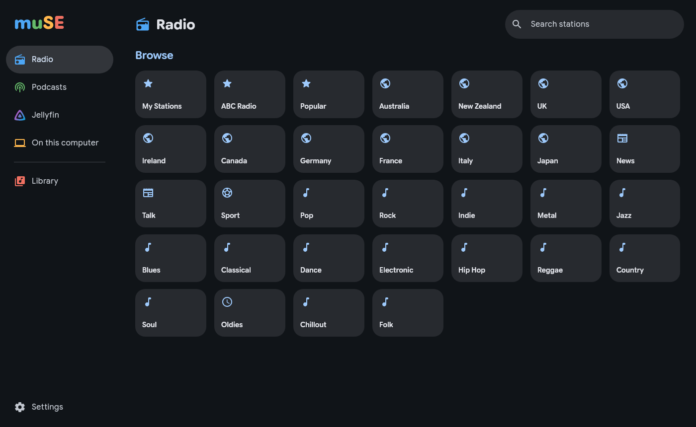

# muSE

A music player for the Ubuntu desktop: **internet radio**, **podcasts**, your **Jellyfin** music library and the **music on your computer**, in one Material 3 app that takes its colours from what's playing. Playback is [mpv](https://mpv.io).



- **Radio**: thousands of stations from radio-browser.info by country and genre, search, plus TuneIn and a community list when adding your own. Live track names, favourites, history, and reconnecting when a stream drops.
- **Podcasts**: search Apple Podcasts and fyyd, add any feed, import an OPML export (AntennaPod and most apps make one). Continue listening, downloads, show notes, per-show speed.
- **Jellyfin**: home, albums, artists, songs, playlists and search; gapless play, shuffle and repeat, Up next, synced lyrics, Instant Mix, volume levelling from ReplayGain. Favourites and play counts go back to the server.
- **On this computer**: your Music folder (and any others) with tags and covers. "Open with muSE" works from Files.
- GNOME's media controls and your keyboard's media keys work with it (MPRIS).
- Share links: copy a link to a station, song, album, show or episode; paste one (Ctrl+V) to open it. Set the web address links are made on in Settings.

## Install

Download the `.deb` from [Releases](../../releases/latest), then:

```bash
sudo apt install ./muse_*_amd64.deb
```

`apt` fetches what it needs (libmpv, ffmpeg, zenity, libsecret). Java comes bundled. Tested on Ubuntu 26.04.

## Build

Needs JDK 21 (with `jpackage`) and `libmpv2`.

```bash
./gradlew run                 # run from source
packaging/package.sh --public # build/public/muse_<version>_amd64.deb
```

Built with Kotlin and Compose Multiplatform. Fonts: Google Sans Flex and NeverMind (SIL Open Font License).
